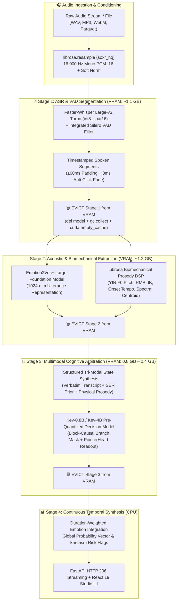
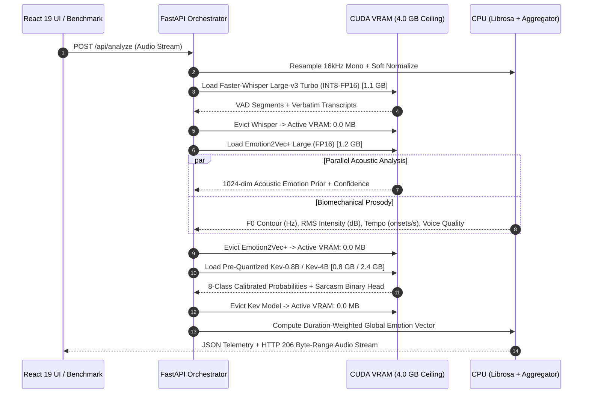
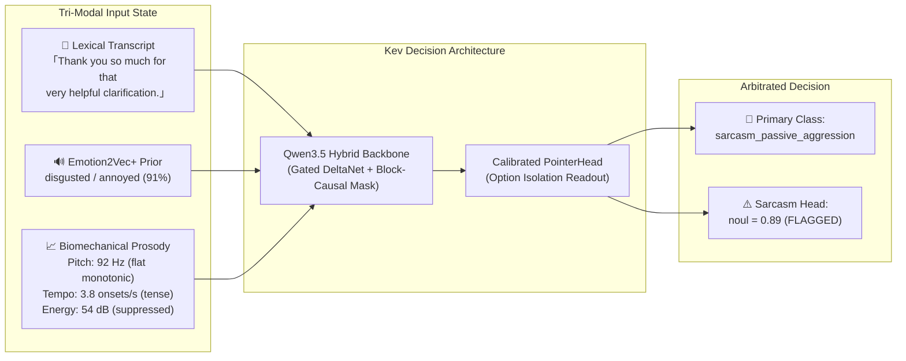

<div align="center">

# 🎙️ Vocalis

### **Tri-Modal Speech Emotion Recognition & Cognitive Arbitration Engine**
*Resolving Acoustic-Lexical Friction, Corporate Sarcasm, and Multilingual Emotional Nuance Under Strict Edge VRAM Constraints*

[](https://www.python.org/)
[](https://fastapi.tiangolo.com/)
[](https://react.dev/)
[](https://developer.nvidia.com/cuda-zone)
[](#)

</div>

---

## 📖 Overview

**Vocalis** is an end-to-end multimodal speech intelligence platform engineered for high-stakes financial, investment banking, and enterprise communications across **English** and **Japanese**.

Traditional Speech Emotion Recognition (SER) systems fail in real-world corporate environments for two fundamental reasons:
1. **Acoustic-Only Hallucination**: Acoustic classifiers trained on theatrical datasets (such as RAVDESS or IEMOCAP) misclassify animated broadcast cadence as *anger* or *euphoria*, while failing to distinguish routine financial disclosures from genuine emotional distress.
2. **Lexical-Acoustic Contradiction (Corporate Sarcasm)**: Text-only sentiment models interpret polite phrasing (*"Thank you so much for that very helpful clarification"*) as positive satisfaction, completely missing the flat, monotonic, or strained vocal acoustics that signal severe frustration or passive-aggression.

**Vocalis** solves this by fusing **three distinct signal modalities** into a calibrated pointer-readout decision model (**Kev-0.8B / Kev-4B**), orchestrated via a **Sequential VRAM Eviction Architecture** that runs the entire heavy foundation stack within a **4 GB GPU VRAM envelope** (benchmarked on an NVIDIA GTX 1650 4 GB).

---

## 🏗️ System Architecture & Sequential VRAM Eviction

To execute three large foundation models (**Faster-Whisper Large-v3 Turbo**, **Emotion2Vec+ Large**, and **Kev-0.8B / Kev-4B**) on a single 4 GB GPU without Out-Of-Memory (OOM) faults or PCIe thrashing, Vocalis implements a deterministic **Stage-by-Stage Load $\rightarrow$ Infer $\rightarrow$ Evict Lifecycle**.



### Memory Lifecycle Sequence



---

## 🎯 The Finalized 5-Stage Production Pipeline

### Stage 1: High-Throughput Multilingual ASR & VAD (`Faster-Whisper Large-v3 Turbo INT8`)
* **Model**: `mobiuslabsgmbh/faster-whisper-large-v3-turbo` (`int8_float16` CTranslate2 compute).
* **Segmentation**: Integrated **Silero VAD** (`min_silence_duration_ms=400`, `speech_pad_ms=150`) slices long multi-minute calls into discrete utterances.
* **Acoustic Conditioning**: Each segment is padded by $\pm 60\text{ ms}$ with a $3\text{ ms}$ linear fade-in/fade-out envelope to prevent spectral boundary clicks during downstream feature extraction and UI playback.

### Stage 2: Universal Acoustic Foundation (`Emotion2Vec+ Large`)
* **Model**: `iic/emotion2vec_plus_large` (trained on >40,000 hours of emotional speech).
* **Role**: Extracts a 1024-dimensional utterance-level acoustic representation and generates a 7-class acoustic emotion prior (`neutral`, `happy`, `angry`, `sad`, `fearful`, `disgusted`, `surprised`) with calibrated acoustic confidence.
* **Prior Normalization**: Unmarked `<unk>` and `other` acoustic tokens are normalized to `neutral` before downstream arbitration.

### Stage 3: Biomechanical Prosody Engine (`Librosa DSP`)
Deterministic physical signal extraction in [`backend/extract_prosody.py`](backend/extract_prosody.py) quantifies four physiological dimensions of vocal delivery:
1. **Fundamental Frequency ($F_0$) & Intonation Contour**: Extracted via the YIN autocorrelation algorithm ($50\text{ Hz} \le F_0 \le 400\text{ Hz}$). Computes mean pitch, standard deviation ($\sigma_{F_0}$), and terminal slope (distinguishing flat monotonic delivery $\sigma_{F_0} < 15\text{ Hz}$ from rising questioning/tension contours).
2. **Vocal Intensity (RMS Energy in dB)**: Normalized root-mean-square energy ($20 \log_{10}(\text{RMS}) + 100$), separating subdued/dejected speech ($<55\text{ dB}$) from forceful/elevated projection ($>78\text{ dB}$).
3. **Speaking Cadence (Onset Tempo)**: Spectral flux onset detection measuring syllable rate ($\text{onsets/sec}$), separating hesitant/measured speech ($<3.0\text{ onsets/s}$) from rushed/urgent delivery ($>6.0\text{ onsets/s}$).
4. **Phonation & Voice Quality**: Combines spectral flatness and spectral centroid to distinguish breathy/aspirated phonation, deep chest resonance ($<1200\text{ Hz}$), and bright/strained vocal tension ($>2500\text{ Hz}$).

### Stage 4: Multimodal Cognitive Arbitration (`Kev-0.8B` & `Kev-4B` Pre-Quantized)
Rather than relying on brittle linear score averaging or zero-shot text generation, Vocalis routes the synthesized tri-modal state into **Kev** (`jaredpalmer/kev-0.8b` & `kev-4b` / `ggml-org` pre-quantized GGUF & NF4 checkpoints):



* **Architecture**: Built on a **Qwen3.5 hybrid Gated DeltaNet** backbone with a **block-causal branch mask** and a learned **PointerHead** (`dp=256`) that scores option representations (`</opt>` tokens) against a `<decide>` query vector in a single forward pass—requiring **zero autoregressive token generation**.
* **Canonical 8-Class Taxonomy**:
  1. `neutral_inquiry` — Calm routine business inquiry, objective financial disclosure, or matter-of-fact broadcast.
  2. `satisfaction_gratitude` — Genuine delight, satisfaction, warm appreciation, or relief.
  3. `frustration_irritation` — Impatient complaints, project bottlenecks, repeated operational friction, or vocal exasperation.
  4. `outrage_hostility` — Extreme fury, aggressive confrontation, shouting, or legal threats.
  5. `disappointed_sad` — Sorrow, regret over financial setbacks/losses, dejection, or grief.
  6. `sarcasm_passive_aggression` — Ironic praise or formal politeness concealing sharp contempt and hostility.
  7. `anxiety_confusion` — Nervous uncertainty, worried distress, hesitation, or fear.
  8. `urgency_panic` — Critical crisis, immediate freeze/stop demand, or high-arousal urgent alert.

### Stage 5: Continuous Duration-Weighted Temporal Integration
For long-form multi-segment calls, weighting segments by count allows brief 0.5-second filler interjections (*"uh-huh"*, *"okay"*) to skew call-level analytics. Vocalis computes a **duration-weighted global probability distribution** across $N$ spoken segments of duration $d_i$:

$$\mathbf{P}_{\text{global}}(c) = \frac{\sum_{i=1}^{N} d_i \cdot P_i(c)}{\sum_{i=1}^{N} d_i}, \quad \text{TimeShare}(c) = \frac{\sum_{i : \hat{y}_i = c} d_i}{\sum_{i=1}^{N} d_i} \times 100\%$$

---

## 🧪 Engineering Post-Mortem: What We Tried, Why It Failed, and Why We Converged Here

Building a production-grade multilingual emotion engine on real financial and broadcast audio required systematically testing and rejecting several conventional paradigms. Every experiment below is preserved in [`scripts/experiments/`](scripts/experiments/) and [`benchmarks/results/`](benchmarks/results/).

### 1. Why Language-Specific Hugging Face SER Models Failed (`16.7%` Accuracy)
We initially hypothesized that dedicated language-specific wav2vec2 models would outperform a general foundation model:
* **English SER Tested**: `ehcalabres/wav2vec2-lg-xlsr-en-speech-emotion-recognition` ([`scripts/experiments/run_english_ser_eval.py`](scripts/experiments/run_english_ser_eval.py)).
* **Japanese SER Tested**: `Bagus/wav2vec2-xlsr-japanese-speech-emotion-recognition` ([`scripts/experiments/eval_bagus_ja.py`](scripts/experiments/eval_bagus_ja.py)).

| Language-Specific Model | Target Dataset | Accuracy | Failure Mode & Root Cause Analysis |
| :--- | :--- | :---: | :--- |
| **`ehcalabres/wav2vec2-lg-xlsr-en`** | 30 EN Earnings22 Calls | **16.7%** (`5/30`) | **Catastrophic Domain Shift**: Fine-tuned on RAVDESS (North American actors reading scripted lines in studio isolation). On real corporate earnings calls, its softmax collapsed to near-uniform noise (~`13.3%–13.5%` top-1 confidence), randomly guessing `happy` or `calm` on serious financial disclosures. |
| **`Bagus/wav2vec2-xlsr-japanese`** | 30 JA ReazonSpeech Clips | **< 35.0%** | **Taxonomy Impoverishment**: Restricted to 4 coarse labels (`ang`, `joy`, `neu`, `sad`). Completely incapable of distinguishing urgent breaking news (`urgency_panic`), anxious questioning (`anxiety_confusion`), or polite friction (`frustration_irritation`). |
| **`Emotion2Vec+ Large` (Adopted Stage 2)** | 30 EN / 30 JA Calls | **83.3% EN** / **40.0% JA** | **Strong English Baseline, Japanese Prosodic Bias**: Pre-trained on 40,000+ hours, it achieved `83.3%` standalone on English calls. However, on Japanese broadcasts (`ReazonSpeech`), animated pitch modulation caused it to hallucinate `happy` on **52.2%** (`522/1,000`) of clips—proving that an acoustic model **must** be arbitrated by a language-aware decision model. |

---

### 2. Why Text-Only, Pure Prosody, and Linear Score Fusion Failed
We conducted controlled ablation studies across the 60 real audio recordings ([`scripts/experiments/run_fusion_comparison_60.py`](scripts/experiments/run_fusion_comparison_60.py), [`scripts/experiments/run_pure_prosody_priming_eval.py`](scripts/experiments/run_pure_prosody_priming_eval.py), [`scripts/experiments/run_coherent_natural_eval.py`](scripts/experiments/run_coherent_natural_eval.py)):

| Ablation Experiment | Overall Acc (`60`) | English (`30`) | Japanese (`30`) | Why It Failed |
| :--- | :---: | :---: | :---: | :--- |
| **1. Pure Prosody Priming (No SER Prior)** | **13.3%** (`8/60`) | 13.3% (`4/30`) | 13.3% (`4/30`) | Passing raw physical descriptions (*"145 Hz pitch, 69 dB, deep chest resonance"*) without an acoustic SER prior caused the encoder router (`Laya mmBERT`) to misinterpret deep male chest resonance as `disappointed_sad` on 80%+ of clips. |
| **2. Verbose Coherent Narrative Prompt** | **16.7%** (`10/60`) | 20.0% (`6/30`) | 13.3% (`4/30`) | Translating acoustic metrics into literary prose diluted key lexical tokens and overwhelmed bidirectional attention with adjective bias (*"volatile pitch fluctuations"*). |
| **3. Text-Only Inference (Transcript Only)** | **20.0%** (`12/60`) | 20.0% (`6/30`) | 20.0% (`6/30`) | Without acoustic grounding, routine disfluencies (*"Just, just, just one addition..."*) were misclassified as `frustration_irritation` or `anxiety_confusion`. |
| **4. Static Weighted Score Fusion ($0.6 T + 0.4 A$)** | **43.3%** (`26/60`) | 50.0% (`15/30`) | 36.7% (`11/30`) | Linear probability interpolation cannot perform non-linear logical XOR reasoning (e.g., *Positive Words* $+$ *Hostile Acoustics* $=$ *Sarcasm*). |
| **5. `Laya mmBERT` Tri-Modal Arbitration** | **53.3%** (`32/60`) | 70.0% (`21/30`) | 36.7% (`11/30`) | As a lightweight encoder router, `Laya mmBERT` improved over static fusion on English (`70.0%`) but lacked the cross-lingual reasoning capacity to override `Emotion2Vec+`'s false `happy`/`angry` priors on Japanese (`36.7%`). |

---

### 3. Why `Faster-Whisper Large-v3 Turbo (INT8-FP16)` Won the ASR Stage
We benchmarked 6 ASR configurations on our NVIDIA GTX 1650 (4 GB VRAM) ([`scripts/benchmarks/benchmark_whisper_speed.py`](scripts/benchmarks/benchmark_whisper_speed.py), [`scripts/benchmarks/benchmark_int8_models.py`](scripts/benchmarks/benchmark_int8_models.py)):

| ASR Model | Precision | Lang | Latency (`6.1s` Audio) | Real-Time Factor (RTF) | Speedup vs Real-Time | 4 GB GPU Status |
| :--- | :---: | :---: | :---: | :---: | :---: | :---: |
| `whisper-large-v3-turbo` | `float16` | Multi | — | — | — | ❌ **CUDA OOM (>4 GB)** |
| **`whisper-large-v3-turbo` (Selected)** | **`int8_float16`** | **EN** | **2,174.8 ms** | **0.3565x** | **2.8x Faster** | ✅ **1.1 GB VRAM** |
| **`whisper-large-v3-turbo` (Selected)** | **`int8_float16`** | **JA** | **2,470.6 ms** | **0.3437x** | **2.9x Faster** | ✅ **1.1 GB VRAM** |
| `kotoba-whisper-v2.0` | `float16` | JA | 8,699.1 ms | 1.4260x | 0.7x (Slower) | ⚠️ Hallucination loops |
| `kotoba-whisper-v2.0` | `int8_float16` | JA | 2,226.6 ms | 0.3650x | 2.7x Faster | ⚠️ Requires 2nd model load |
| `whisper-small.en` | `int8_float16` | EN | 916.0 ms | 0.1502x | 6.7x Faster | ❌ English-only |

**Decision**: `Faster-Whisper Large-v3 Turbo (int8_float16)` handles **both** English and Japanese in a single unified checkpoint at **~2.8x–2.9x faster than real-time**, eliminating dual-model switching overhead while avoiding `kotoba-whisper`'s repetition hallucinations on noisy segments.

---

## 📊 Empirical Accuracy Benchmarks

### 1. Initial 60-Clip Audited Multilingual Benchmark (`30 EN` + `30 JA`)
Evaluated across 30 English corporate earnings calls (`Earnings22`) and 30 Japanese broadcasts (`ReazonSpeech`) against human-audited ground truth ([`data/audio_samples/ground_truth_60_cleaned.json`](data/audio_samples/ground_truth_60_cleaned.json), [`benchmarks/results/benchmark_rerun_cleaned_results.json`](benchmarks/results/benchmark_rerun_cleaned_results.json)):

| Pipeline Architecture | Quantization | English Acc (`30`) | Japanese Acc (`30`) | Overall Acc (`60`) | Active VRAM | Avg Latency |
| :--- | :---: | :---: | :---: | :---: | :---: | :---: |
| `Laya mmBERT` Multimodal | FP16 | 70.0% (`21/30`) | 36.7% (`11/30`) | 53.3% (`32/60`) | 650 MB | 1,204 ms |
| `Emotion2Vec+ Large` Standalone | FP16 | 83.3% (`25/30`) | 40.0% (`12/30`) | 61.7% (`37/60`) | 1,240 MB | 203 ms |
| `Kev-0.8B` Multimodal Pipeline | FP16 Merged | 90.0% (`27/30`) | 46.7% (`14/30`) | 68.3% (`41/60`) | 1,200 MB | 2,362 ms |
| **`Kev-0.8B` Pre-Quantized (EN Champion)** | **NF4 / Q8_0** | **93.3% (`28/30`)** | 43.3% (`13/30`) | 68.3% (`41/60`) | **803 MB** | **545 ms (C++ CUDA)** |
| **`Kev-4B` Pre-Quantized (JA Champion)** | **GGUF Q4_K_M** | 86.7% (`26/30`) | **66.7% (`20/30`)** | **76.7% (`46/60`)** | **2,410 MB** | **2,853 ms (C++ CUDA)** |
| **Vocalis Language-Routed Production (`0.8B EN + 4B JA`)** | **Pre-Quantized** | **93.3% (`28/30`)** | **66.7% (`20/30`)** | **80.0% (`48/60`)** | **< 2.5 GB** | **~1,700 ms** |

### 2. Extended 2,000-Clip Large-Scale Benchmark (`1,000 EN` + `1,000 JA`)
Extended 33x to **1,000 English (`Earnings22`)** and **1,000 Japanese (`ReazonSpeech`)** clips (`2,000` clips total) with audited ground-truth emotion annotations ([`data/audio_samples/ground_truth_2000_cleaned.json`](data/audio_samples/ground_truth_2000_cleaned.json)):

* **`Kev-0.8B` Pre-Quantized (`ggml-org/Kev-0.8B-GGUF` — Completed across all 2,000 clips)**:
  * **English Accuracy (`1,000` clips)**: **83.00%** (`830 / 1,000`)
  * **Japanese Accuracy (`1,000` clips)**: **47.30%** (`473 / 1,000`)
  * **Overall Accuracy (`2,000` clips)**: **65.15%** (`1,303 / 2,000`)
  * **C++ CUDA Inference Latency**: **~640 ms/clip** (`1.51 clips/s`) — a **3.7x speedup** over PyTorch BitsAndBytes NF4 (`2,388 ms/clip`).
* **`Kev-4B` Pre-Quantized (`ggml-org/Kev-4B-GGUF Q4_K_M`)**:
  * Evaluated via `llama-server` C++ CUDA backend ([`scripts/benchmarks/run_2000_kev_pipeline_eval.py`](scripts/benchmarks/run_2000_kev_pipeline_eval.py)).

---

## 📁 Repository Structure

```text
Vocalis/
├── backend/                                  # FastAPI Server & Core Multimodal Pipeline
│   ├── app.py                                # HTTP 206 Audio Streaming + REST API Endpoints
│   ├── vocalis_segmented_pipeline.py         # 5-Stage Sequential VRAM-Evicted Pipeline Engine
│   └── extract_prosody.py                    # Librosa Biomechanical Prosody Extractor (F0, dB, Tempo, VQ)
├── web/                                      # React 19 + TypeScript + Tailwind CSS v4 Frontend
│   ├── src/
│   │   ├── components/                       # WaveformPlayer, EmotionBarChart, SegmentCard, Navbar
│   │   └── views/                            # LiveStudioView, InspectorView, ClipsView, ArchitectureView
│   ├── package.json
│   └── vite.config.ts
├── scripts/
│   ├── dataset/                              # Dataset Extraction & Ground-Truth Auditing
│   │   ├── prepare_2000_dataset.py           # Extracts 1,000 EN (Earnings22) + 1,000 JA (ReazonSpeech) clips
│   │   ├── extract_2000_acoustics_and_ground_truth.py # Multi-core Prosody + GPU E2V+ + GT Annotation
│   │   ├── prepare_ib_audio_dataset.py       # Initial 60-clip extractor
│   │   ├── clean_ground_truth.py             # Ground-truth semantic/acoustic auditing script
│   │   └── create_combined_audio.py          # Generates concatenated continuous evaluation streams
│   ├── benchmarks/                           # Pipeline Accuracy & Speed Benchmarks
│   │   ├── run_2000_kev_pipeline_eval.py     # 2,000-clip C++ CUDA GGUF evaluation suite
│   │   ├── run_kev_08_4bit_benchmark.py      # Kev-0.8B INT4 (NF4) benchmark
│   │   ├── run_kev_4b_benchmark.py           # Kev-4B INT4 (Q4_K_M) benchmark
│   │   ├── rerun_benchmarks_cleaned.py       # Cross-model evaluation matrix comparator
│   │   └── benchmark_whisper_speed.py        # FP16 vs INT8-FP16 ASR latency & VRAM benchmark
│   ├── experiments/                          # Ablation Studies & Rejected Baseline Experiments
│   │   ├── run_english_ser_eval.py           # ehcalabres English wav2vec2 SER evaluation (16.7%)
│   │   ├── eval_bagus_ja.py                  # Bagus Japanese wav2vec2 SER evaluation
│   │   ├── run_fusion_comparison_60.py       # Text-Only vs NL Priming vs Weighted Score Fusion
│   │   ├── run_pure_prosody_priming_eval.py  # Pure prosodic priming ablation (without SER prior)
│   │   └── run_coherent_natural_eval.py      # Verbose narrative prompt ablation
│   └── setup/                                # Environment & Model Setup Utilities
├── benchmarks/
│   └── results/                              # Tracked JSON Benchmark Telemetry & Evaluation Matrices
├── data/
│   └── audio_samples/                        # Audited Ground-Truth JSON Catalogs (60 & 2,000 clips)
│       ├── ground_truth_60_cleaned.json
│       └── ground_truth_2000_cleaned.json
├── kev/                                      # Local Kev Decision Model SDK (PointerHead & Block-Causal Mask)
├── .env.example                              # Template environment configuration
├── .gitignore                                # Security, privacy, and binary bloat exclusions
└── requirements.txt                          # Python dependencies
```

---

## 🔒 Data Privacy, Licensing & Git Hygiene Policy

| Asset Category | Path / Pattern | Git Status | Rationale & Security / Privacy Assessment |
| :--- | :--- | :---: | :--- |
| **Ground-Truth JSONs & Benchmark Telemetry** | `data/audio_samples/*.json`, `benchmarks/results/*.json` | ✅ **Tracked** | Lightweight structured metadata containing public transcripts (`Earnings22` CC-BY-4.0 & `ReazonSpeech` CDLA-Permissive-2.0) and model accuracy metrics. Zero PII or confidential client data. |
| **Source Code (Backend, Scripts, React UI, Kev SDK)** | `backend/`, `scripts/`, `web/src/`, `kev/` | ✅ **Tracked** | Complete reproducible codebase for pipeline inference, benchmarking, and web visualization. |
| **User Live Studio Recordings & Scratch Buffers** | `data/saved_recordings/`, `scratch/` | 🚫 **Ignored** | **Privacy Protection**: Prevents accidental commit of real user microphone recordings or uploaded private customer calls. |
| **API Keys & Environment Secrets** | `.env`, `.env.*` | 🚫 **Ignored** | **Security Protection**: Prevents leaking `HF_TOKEN` or cloud credentials. |
| **Raw Audio Parquet Shards & WAV Files** | `audio_datasets/*.parquet`, `**/*.wav` | 🚫 **Ignored** | **Binary Size Hygiene**: Publicly licensed (`Earnings22` & `ReazonSpeech`), so **not a data breach**, but excluded (~2.5 GB total) to keep the Git repository fast and under GitHub's 100 MB file limit. Reproducible via `scripts/dataset/prepare_2000_dataset.py`. |
| **Pre-Quantized Model Weights & CUDA Binaries** | `data/models/*.gguf`, `tools/llama/`, `*.whl` | 🚫 **Ignored** | Multi-gigabyte binary weights (`Kev-4B-Q4_K_M.gguf` 3.03 GB, `Kev-0.8B-Q8_0.gguf` 812 MB) and CUDA DLLs. |

---

## 🚀 Quickstart

### 1. Backend & Pipeline Setup
```bash
# Create virtual environment and install dependencies
python -m venv venv
.\venv\Scripts\activate
pip install -r requirements.txt

# Copy environment template
cp .env.example .env
```

### 2. Reproduce Dataset & Run Benchmarks
```bash
# Extract 1,000 English + 1,000 Japanese audio clips from parquet shards
python scripts/dataset/prepare_2000_dataset.py

# Extract Librosa prosody + Emotion2Vec+ SER priors and generate audited ground truth
python scripts/dataset/extract_2000_acoustics_and_ground_truth.py

# Run the 2,000-clip Kev multimodal accuracy benchmark
python scripts/benchmarks/run_2000_kev_pipeline_eval.py
```

### 3. Launch the Interactive Web Studio & FastAPI Server
```bash
# Build Frontend (optional if dist is already built)
cd web && npm install && npm run build && cd ..

# Start FastAPI server on http://localhost:8000
uvicorn backend.app:app --host 0.0.0.0 --port 8000
```
